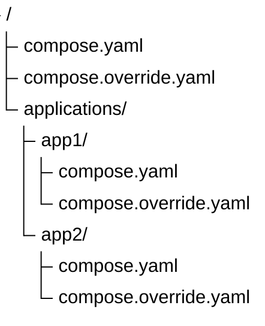
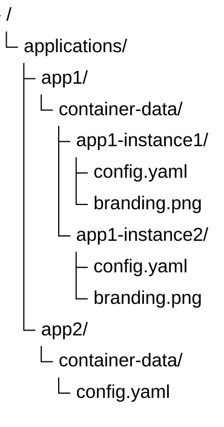
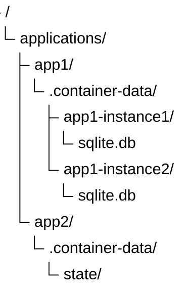
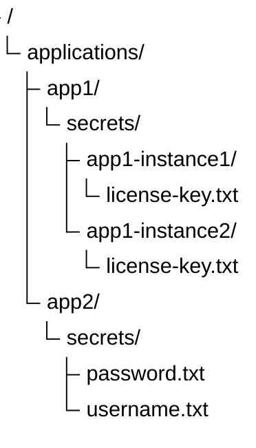

# [Hack Portland](https://www.meetup.com/hack-portland/) Self-Hosting Presentation

Attendees of the Hack Portland meetup group, on multiple occasions, have asked me how I safely and simply self-host over two-dozen services in my personal quest to regain control of my data, cut costs, and enhance my digital life. To that end, I have created this branch of my personal showcase repository to demonstrate how anyone can use professional techniques, like Infrastructure as Code (IaC), along with free-tier cloud services, to self-host a variety of services with minimal cost and effort. The structure and contents of this branch are representative of the live site I host from my homelab for myself, but have been simplified for demonstration purposes.

### Self-hosted site goals
- **Minimal cost**
	 I will only use free-tier services, with few exceptions.
- **Minimal maintenance effort** (upgrades, monitoring, etc.)
	 I will use IaC and automation to reduce the time I spend maintaining and expanding my site.
- **Minimal recovery effort** (from failures, such as power outages and hardware failures)
	 I will use IaC, version control, data organization to reduce the time I spend recovering from failures.
	 *Actual backup/restore plans are out of scope for this demo, but I plan on covering them during my separate, homelab-focused presentation.*
- **Professional techniques**
	 I will use professional techniques, such as IaC and automation, to manage my site and develop skills that are marketable in the IT/DevOps job market.
- **Privacy**
	 I will avoid using third-party services that track or monetize my data.
- **Security**
	 I will use best practices to secure my site and data from unauthorized access and protect my site from common attacks.
- **Portability**
	 I will use cloud services and containerization to make it easy to move my site and data to different hardware or cloud providers if needed.
- **External accessibility**
	 I will use outbound-only connections and DNS management to make my self-hosted services accessible from anywhere with an internet connection. If you are only interested in self-hosting for local network access, you can skip steps marked `optional: required for external accessibility`.

## Technologies and Services Used
- **Domain Registration**
	- $ [Porkbun](https://porkbun.com/about) for affordable, unlocked domain registration
- **Version Control**
	- [Git](https://git-scm.com/) for version control of IaC and configuration files
- **Containerization**
	- [Docker](https://www.docker.com/) for containerizing services for easy deployment and management
- **Infrastructure as Code (IaC)**
	- [Docker Compose](https://docs.docker.com/compose/) for defining and running the containerized services on my homelab
	- [Terraform](https://www.terraform.io/) for provisioning and managing cloud resources
- **Cloud services**
	- [Cloudflare R2](https://developers.cloudflare.com/r2/) for centralized, no-cost cloud storage of Terraform state
	- [Cloudflare Tunnel](https://developers.cloudflare.com/cloudflare-one/connections/connect-apps/) for protected access to self-hosted services and domain portability
	- [GitHub](https://github.com/about) for remote repository hosting of version-controlled files
	- [Google Cloud Platform (GCP) OAuth Client](https://support.google.com/cloud/answer/15549257) for authentication and authorization of secured tunnel routes
- **Self-hosted services**
	- [Microsoft Devcontainers](https://github.com/devcontainers/images) for a secure, remote-accessible, and enriched shell and development environment for managing my IaC and configuration files
	- [File Browser](https://filebrowser.org/) to replace cloud storage services like Google Drive, Dropbox, and OneDrive for file access and management
	- [Grafana](https://grafana.com/) for monitoring and visualizing logs (and eventually metrics) from my homelab and self-hosted services
	- [NordVPN](https://nordvpn.com/) for secure, encrypted, and private internet access from my homelab
	- [Photoprism](https://photoprism.app/) to replace cloud photo storage services like Google Photos, Apple iCloud, and Amazon Photos for photo access and management
	- [Pi-hole](https://pi-hole.net/) for network-wide ad-blocking and DNS filtering to enhance privacy and security of my home network and devices
	- [Traefik](https://traefik.io/) for reverse proxying and TLS termination of my self-hosted services

## Getting Started
Prerequisite steps before writing any code:

1. **Get your hosting environment ready**
	 This could be a Raspberry Pi, a laptop clam-shelled in your closet, a dedicated homelab server, or a cloud VM ($).
	- Ensure sufficient hardware resources for your planned services.
	- Ensure reliable network connectivity.
	- Ensure OS and software are up to date for security and stability.
	- Install
		- Docker
		- Docker Compose
		- Git
		- Terraform (optional, or you can use another host or the development container provided in this repository)

1. **Create a free Cloudflare account** or use an existing one
	 *(optional: required for external accessibility)*
	 Cloudflare provides free-tier services that are ideal for self-hosting, including DNS management, object storage, and secure tunneling to your services.
	- Follow-up:
		- Create a Cloudflare API token with appropriate permissions for Terraform management of your site.
			- Because your new site (a.k.a. Cloudflare "Zone") has yet to be created, you can create a token with all required permissions and "Zone Resources" to include "All zones from an account", then restrict to the specific zone once it's created.
			- See [Appendix: Cloudflare API Token Permissions](#cloudflare-api-token-permissions) for required permissions.
		- Create a free R2 bucket to be used as the Terraform state backend and an R2 API token for access.
			 https://developers.cloudflare.com/terraform/advanced-topics/remote-backend/

1. **Obtain a domain name** or use an existing one that supports DNS management by Cloudflare
	 *(optional: required for external accessibility)*
	 A domain name will enable you to access your self-hosted services from anywhere using friendly URLs without a static IP address from your ISP and enable SSL/TLS encryption for secure connections.
	- I use Porkbun as my domain registrar:
		- Cheap domains
		- Unlocked domains, [in contrast to Cloudflare](https://porkbun.com/about/porkbun-vs-cloudflare)
		- Rated top registrar many years in a row

## Deploy your Cloud Infrastructure
*(optional: required for external accessibility)*

The objective of this section is to provision and configure the cloud resources required to securely expose your self-hosted services to the internet.

To meet the goals of
- minimal maintenance effort
- professional techniques

I use Terraform to provision and manage my cloud resources. Not all cloud resources support Terraform or IaC, but I make an effort to select resources that do.

In this section, I will cover:
- Theory - how and why I structure my Terraform files to meet my goals
- Specific resources - examples of specific cloud resources I use to securely expose my self-hosted services
- Manual configuration - some cloud resources do not support Terraform or IaC, so I will cover the manual configuration required for those resources

### Theory: Structuring your Terraform project
*(optional: required for external accessibility)*

To keep with the modular structure that will be set up with the Compose project, Terraform specific to a service should be in that service's directory. Similar to the root Compose file, the root Terraform module is the sole exception to this, as it must reference the application submodules to create the full infrastructure. To avoid also leaking service information required to configure routes into the `cloudflared` module definition, we can make use of dynamic Terraform to pass the configuration through the root module: more on this in the [Ingress](#ingress) section.

This means that creating or removing a service will involve touching the root and the service's Terraform files, but maintaining a service will generally only involve touching the service's Terraform files.

Use the following articles, as well as the contents of this repository, to plan and create your Terraform configuration files.
- https://www.terraform-best-practices.com/
- https://registry.terraform.io/

### Manage your Domain with Cloudflare

The objective of this section is to add your domain to Cloudflare for DNS management, which is a prerequisite for using Cloudflare Tunnel to securely expose your self-hosted services to the internet.

For me, this section represents the most work done by hand in online dashboards to create my cloud resources, due to Porkbun not having a comprehensive Terraform provider.

If you use a different registrar that supports Terraform, you may be able to automate more of these steps. And if you use Cloudflare as your registrar, you can skip most of these steps entirely.

1. **Disable DNSSEC at your registrar** if your registrar is not Cloudflare
	 [DNSSEC](https://www.cloudflare.com/learning/dns/dnssec/how-dnssec-works/) is good for security, but Cloudflare will manage it for you once your domain is managed there. Cloudflare provides links to instructions for many popular registrars.
	 https://developers.cloudflare.com/dns/zone-setups/full-setup/setup/#before-you-begin

1. **Terraform-apply the minimal resources required/recommended to create a Cloudflare site**
	- `cloudflare_zone` - to create and manage your Cloudflare Zone (i.e. your site/domain)
	- `cloudflare_zone_dnssec` - to enable DNSSEC for your site

1. **Update your domain's nameservers at your registrar** if your registrar is not Cloudflare
	 When managed by Cloudflare, your domain must use the Cloudflare nameservers assigned to your zone. Cloudflare provides links to instructions for many popular registrars.
	 https://developers.cloudflare.com/dns/zone-setups/full-setup/setup/#update-your-registrar

1. **Re-enable DNSSEC at your registrar** if your registrar is not Cloudflare
	 Now that Cloudflare is managing your domain, you can re-enable DNSSEC using the DS record values provided by Cloudflare, which you can find in the Terraform output of this repository. You can re-use the same instructions from the step to disable DNSSEC.

At this point, you can view your domain in the [Cloudflare dashboard](https://dash.cloudflare.com/), but accessing it in a browser will result in the error `DNS_PROBE_FINISHED_NXDOMAIN` because no DNS records exist yet (unless you had existing records prior to moving to Cloudflare).

### Create DNS records for your domain

To reach your self-hosted services via your domain, you need to create [DNS](https://www.cloudflare.com/learning/dns/what-is-dns/) records that point to the Cloudflare Tunnel that will be the gateway to your services.

In the past, I have created DNS records per subdomain (e.g. `service1.example.com`, `service2.example.com`) in order to be more declarative about my infrastructure and to keep the door open for using other hosting methods under the same domain or changing proxy status in the future. This approach has the downside of lag-time between creating DNS records for new services and being able to access the services, due to DNS propagation time.

For this site and demonstration, I am using a wildcard DNS record to point all subdomains to the same Cloudflare Tunnel. Note that this still requires an additional DNS record for the apex/root domain (e.g. `example.com`) if you want to host services there as well.

1. **Terraform-apply the Cloudflare Tunnel and the DNS record(s) pointing to it**
	- `cloudflare_zero_trust_tunnel_cloudflared` - to define the cloud-side of the Cloudflare Tunnel
	- `cloudflare_dns_record` - to create the DNS record(s) pointing to the tunnel

> [!WARNING]
> DNS changes take time to propagate: you can continue with deploying your infrastructure and services but may not be able to access them via your domain until propagation is complete.

Once the DNS entries propagate, accessing your domain will result in a HTTP 530, Cloudflare 1033, error page: you have successfully set up DNS resolution to reach Cloudflare servers, but have not yet set up the tunnel to receive and route traffic to your self-hosted services. The other end of the tunnel is the `cloudflared` container covered in [Ingress](#ingress) while the routes to your services are covered in each service's respective section.

#### Footnote: Cloudflare Tunnel Terms of Service
Cloudflare Tunnel [ToS](https://www.cloudflare.com/en-gb/service-specific-terms-application-services/#content-delivery-network-terms) prohibits certain types of content and traffic, such as video streaming, when using their CDN. If you want to access such content off your hosting environment's network, my research indicates that disabling the proxy status of the DNS record (i.e. using "DNS only" mode) should make you compliant. There are security implications to consider when doing so: do your research.

### Create Cloudflare Tunnel identity providers for additional security
*(optional: recommended for additional security)*

To enhance the security of your self-hosted services, you can configure identity providers (IdPs) in Cloudflare Tunnel to require authentication before traffic ever reaches your hosting environment. This can greatly assist your services that may have slower vulnerability patch cycles or lack robust built-in authentication mechanisms.

> [!WARNING]
> This is not a replacement for securing your services themselves, and will not affect requests that bypass the tunnel (e.g. direct IP access or LAN access).

To my dismay, I learned while writing this document that GCP does not have all the Terraform resources required to manage the GCP components of this integration using IaC, so you will need to do some manual configuration in the GCP dashboard. Cloudflare has good documentation for this integration: https://developers.cloudflare.com/cloudflare-one/integrations/identity-providers/google/

## Deploy your Self-Hosted Services

This section is where we finally do what we set out to do: self-host services on our own hardware!

The objective of this section is to deploy and manage your self-hosted services on your hosting environment.

To meet the goals of
- minimal maintenance effort
- minimal recovery effort
- portability

I use Docker and Docker Compose to containerize, orchestrate, and manage my self-hosted services. Containerization makes it easy to deploy, update, and move services between different hardware or cloud providers. Compose files provide a declarative way to define and manage multi-container applications. By selectively using local bind mounts and Docker volumes, I can separate service data from the containers themselves, making it easier to back up and restore data as needed.

In this section, I will cover:
- Theory - how and why I structure my Compose files and organize service data to meet my goals
- Specific services - examples of specific services I believe make for a strong foundation for a self-hosted platform, such as reverse proxies, authentication services, and monitoring tools

The idea is that you can use the theory and infrastructure examples provided to plan and create your own Compose files for the services you want to self-host.

### Theory: Structuring your Compose project

Use the following articles, as well as the contents of this repository, to plan and create your Compose files.
- https://medium.com/@kinghuang/docker-compose-anchors-aliases-extensions-a1e4105d70bd
- https://docs.docker.com/compose/how-tos/use-secrets/
- https://docs.docker.com/compose/how-tos/multiple-compose-files/

#### Repository Layout

The repository layout is designed to be modular and organized, with the root Compose file acting as a thin entrypoint that assembles application modules, while each application directory owns its own services, networks, secrets, and data layout. The structure allows for clear separation of concerns, easier maintenance, and better scalability as new services are added.

Docker Compose's native support for "override" files allows for environment-specific configurations and host architecture differences without duplicating the entire Compose file or modifying the base configuration common to all environments and committed to version control.

Utilizing override files at the root level allows you to extend this "base" Docker landscape with additional Compose projects maintained outside this repository, but from a singular `docker compose ...` entrypoint.

#### YAML Organization and Reuse

Docker Compose allows for YAML anchors to promote reuse and reduce duplication in your Compose files.

By defining common service configurations as reusable blocks, you can maintain consistency across services and simplify updates. The same technique can be applied to individual values as well, avoiding duplication of magic strings which reduces risk of typos and drift during updates.

#### Service Lifecycle Patterns

"If it's worth doing, it's worth doing all the way."

A core pillar of this repository is to use IaC to concretely define and manage your self-hosted services. In this spirit, we don't want to use Compose to spin up a service, then manually configure it through its web dashboard or CLI. In the event of porting your services to a new hosting environment, or even disaster-recovery, you would have to repeat the manual configuration steps, which is time-consuming and error-prone.

The best services allow for complete configuration with files and service environment variables that can be committed to version control. When this is not possible, "bootstrapping" is necessary.

To accomplish this, this repository uses ephemeral "setup" Compose services to perform the initial configuration of a service. Using containers over host-side scripts allows for a more consistent and reproducible setup process, as well as access to tools and dependencies that may not be available on the host system, for example a service's own CLI. In Kubernetes, this pattern is known as an "init container".

This repository automates the execution of these setup services by utilizing the `depends_on` directive in the Compose file to ensure that the setup service runs, and completes successfully, before the main service starts. A slight downside of this approach is that the setup containers will need to be removed manually after they have exited, but it has been the universally accepted approach to this problem in the Docker community for years.

As of late 2025, Compose officially supports [init containers](https://docs.docker.com/compose/how-tos/init-containers/), which creates cleaner syntax and better management of lifecycle containers around a service both before and after startup and shutdown. However, my excitement for this feature was quickly tempered by the fact that it does **not** support overriding the `entrypoint` of an image, making complex setup significantly more difficult. Until this is supported, I will continue to use the `depends_on` pattern for setup containers.

#### Persistent Data Layout

Services frequently require some form of persistent data to maintain state across container restarts and upgrades. This section covers the different types of persistent data and how to manage them effectively.

##### Version-Controlled

Often configuration files, branding assets, and other static files are required by a service and cannot be part of the Compose file itself. These files should be stored in version control alongside the Compose files to ensure that they are backed up, tracked, and can be easily restored or rolled back if needed.

These files are stored in the visible `applications/<service>/container-data[/<service-instance>]` directory and are bind-mounted into the container at runtime. This allows for easy access and modification of the files without needing to rebuild the container image or porting changes from the runtime back to the repository.

##### Non-Version-Controlled; State-Critical

Stateful services will have runtime data that is not suitable for version control but is critical for continuity of service. Such data would be critical to back up and restore in the event of a failure, and thus should be stored in a location that is not ephemeral and is easily accessible for backup and restore operations.

One option is to use isolated Docker volumes that are tarballed during backup operations. This approach is simple and effective, but can be more difficult to manage if you already have a filesystem backup strategy in place.

Another option, which this repository uses, is a bind-mounted directory in a hidden `applications/<service>/.container-data[/<service-instance>]` directory. This approach
- mirrors the version-controlled data layout, making it easier to manage and understand
- hides the data from casual browsing of the repository, reducing the risk of accidental modification or deletion
- allows for easier backup and restore operations using existing filesystem backup strategies

##### Non-Version-Controlled; Non-Critical

Some stateful services may have runtime data that is not suitable for version control and is not critical for continuity of service: having this data persist across container restarts and upgrades is preferred, but not required and losing it across host migrations or failures is acceptable.

Docker volumes are a good fit for this type of data, as they provide persistence across container restarts and upgrades, but can be easily recreated if lost.

#### Secrets Management

Secrets is a different category of data that
- is managed by the administrator, not the application, and therefore needs visibility
- unlike the visible, version-controlled data that is also admin-maintained, should **not** be stored in version control.
- is critical for the functionality of the application.
- requires obfuscation from processes that do not need access to the information.

To that end, secrets are stored in non-hidden, globally git-ignored directories named `applications/<service>/secrets[/<service-instance>]`, and are specially mounted into containers using Compose's [`secrets`](https://docs.docker.com/compose/how-tos/use-secrets/) syntax.

Quality, security-minded services will offer `FILE_*`/`*_FILE`/etc. environment variables to point to files containing the secrets as an alternative to exposing secret values to anything that can see environment variables (which is a lot of things) or even the entrypoint run command flags.

#### Networking and Exposure

##### Network Segmentation

Another chapter in the security story is networking and limiting exposure should an intrusion occur. In lieu of more traditional network access control lists (NACLs), which are not supported by Compose, we can use the "network segmentation" strategy.

Network segmentation is where each service or group of services is placed on its own isolated network, and only the necessary connections between networks are allowed. Additionally, services that don't need internet access are placed on `internal` networks and networks are configured by default as `attachable=false` to prevent joining the secure network at runtime.

With this approach, even if an attacker gains access to one service, the damage is contained because the compromised service cannot easily communicate with other services outside its isolated network.

In the following diagram, each edge represents a unique Docker Compose network.

##### VPNs

At this time, I am only running a VPN client for my services to connect externally through, so I will only cover VPN clients here for the time being.

However, VPN servers may be something you wish to explore to gain remote access to your Compose network(s).

###### VPN Clients

A VPN client allows your services to connect to external networks securely through an encrypted tunnel. This is useful for maintaining privacy and bypassing geo-restrictions. And for some services, it is critical that a loss of VPN connectivity results in a loss of external network access to prevent data leaks: this is often referred to as a "kill switch" feature and was the deciding factor when I was choosing hosting between Compose and Kubernetes.

Docker Compose allows you to define a [service as the `network_mode`](https://docs.docker.com/engine/network/#container-networks). This enables you to attach a service to the network stack of another container, which is particularly useful for VPN clients to ensure that all traffic from the service goes through the VPN. And if the VPN connection drops, the service will lose external network access, effectively implementing a "kill switch" mechanism.

There are additional considerations when networking in this manner:
- When additional services need to communicate with the VPN-attached service...
  - the additional services must also be attached to the same network.
  - the VPN-attached service must be referenced with the VPN container's network alias or service name by the additional services.
  - service-to-service communication must be configured as split-tunneling in the VPN service to ensure that traffic between services does not get routed externally through the VPN.
- Multiple services sharing the same VPN client will no longer be isolated from each other (breaking the Network Segmentation strategy), as they and the VPN container share the same network. If your VPN license allows, consider running separate VPN client containers for each service to maintain isolation.

#### Plug-and-Play Integrations

Services that are designed to integrate with other containers sometimes have the ability to automate their configuration and communication with those containers through the Docker socket, using Docker labels and other metadata for discovery.

Grafana and Traefik are two examples of services that can leverage Docker labels and the Docker socket in this way: the Traefik reverse-proxy configuration is defined on the downstream services through labels, and Grafana can filter and display metrics based on the labels and metadata of the containers it monitors.

While this approach can greatly simplify the integration, configuration, and maintenance of services, creating a "plug-and-play" environment for containers, it also introduces potential security risks, as it requires granting containers access to the Docker socket, which can be exploited if not properly managed. Though not demonstrated here, it is possible to implement additional security measures, such as using a proxy or wrapper around the Docker socket to limit access and enforce policies.

### Infrastructure

Before jumping into your self-hosted plans with the services you're excited to use, you should stop to consider the less-glamorous infrastructure those services will use.

A good foundation should be seen as a way to facilitate adding your desired services, not a roadblock to their implementation.

#### Ingress
*(optional: required for external accessibility)*

If you want your services to be accessible from outside your local network, you will need to properly configure ingress, reverse proxy, and TLS termination. This ensures that external requests are routed correctly to the appropriate services while maintaining secure communication.

Three more common strategies for this are
- Port Forwarding
- VPN
- **Proxy using a third-party service** -- Used in this guide

##### Port Forwarding

The least secure of the three strategies, port forwarding involves configuring your router to forward specific external ports to the internal IP addresses and ports of your services. While it allows direct access from the internet, it exposes your services to potential attacks and should be used with caution, ideally in combination with strong firewall rules and other security measures.

##### VPN

A VPN allows you to securely connect to your home network from an external location, effectively making your device part of the local network. This method adds a significant layer of security by requiring comprehensive authentication and encrypting the traffic between your device and the home network.

Establishing a VPN connection is accomplished in conjunction with one of the other two strategies, either by
- Port Forwarding: Instead of exposing ports with direct access from the internet to your services, which may have sub-par security, you can expose a single port for the VPN server, ensuring that all external traffic must go through the VPN before reaching your internal services. The VPN server will be designed with robust security to avoid exploits.
- Third-Party Proxy: Instead of exposing any ports, the VPN server establishes an outbound connection to the third-party proxy service, which then handles incoming requests and forwards them to your internal services through the VPN. The third-party proxy service effectively acts as a secure intermediary, reducing the direct exposure of your internal network to the internet. Trust these funded, reputable companies to have better security than you do. Tailscale is a popular option for this setup.

##### Proxy Using a Third-Party Service

A proxy service acts as an intermediary between your internal services and the external internet, handling incoming requests and forwarding them to the appropriate internal service. This is accomplished by deploying an internal service that establishes an outbound connection to the third-party proxy service, which then acts as a secure tunnel for external traffic coming into your network.

This is similar to VPN services, but without exposing the entirety of your internal network or requiring a VPN client configuration on each external device.

The third-party proxy service can also handle some aspects of security before traffic reaches your tunnel service, such as DDoS protection, SSL/TLS termination, and request filtering, further reducing the exposure of your internal network to potential threats.

Note that these services typically require more configuration for supported types of traffic, will have more rules/ToS from the provider regarding what kinds of traffic are allowed, and represents an additional dependency on an external service for the availability and security of your internal services.

##### Cloudflare Tunnel

This guide uses this strategy with the Cloudflare Tunnel service, chosen for
- cost (free)
- support for custom domains from any registrar
- ease of setup and management
- robust security features
- reliable performance

#### Reverse Proxy; TLS Termination

You could access your internal services by memorizing IPs and port numbers and dismissing "insecure connection" warnings from your browser, but this approach is cumbersome and can be simplified with a single service acting as a reverse proxy and TLS terminator.

##### TLS

TLS (Transport Layer Security) is a cryptographic protocol that prevents eavesdropping and tampering of your traffic via man-in-the-middle attacks, and prevents malicious sites from impersonating your services by establishing proof of identity through digital certificates. Traffic over HTTPS is HTTP traffic encrypted with TLS, ensuring both confidentiality and integrity.

Like many effective security measures, TLS is not the simplest to set up and manage correctly and requires precision with copious amounts of configuration. Because of this, it's easier to have a single service hold the certificate and decrypt incoming traffic, rather than configuring TLS individually for each internal service. The trick is to keep the termination as close to the edge of your services as possible, reducing the surface area exposed to potential attacks.

[Let's Encrypt](https://letsencrypt.org/) is a popular certificate authority that provides free TLS certificates with automated issuance and renewal, making it easier to implement HTTPS for your services without the need for manual certificate management. [Certbot](https://certbot.eff.org/) is the preferred standalone client for obtaining and managing these certificates, but many popular proxy services like SWAG and Traefik have built-in support for automatically obtaining and renewing Let's Encrypt certificates.

For those using ingress strategies like Cloudflare Tunnel, it is possible (and even simpler) to allow Cloudflare to hold the certificate and handle TLS termination before traffic reaches your internal services. However, Cloudflare does recommend still using HTTPS between Cloudflare and your internal services to ensure end-to-end encryption. Additionally, TLS termination at the tunnel would not provide HTTPS for connections between devices on your network unless they first egress to the internet first, increasing latency.

##### Reverse Proxy

A [reverse proxy](https://www.cloudflare.com/learning/cdn/glossary/reverse-proxy/) is a server that sits in front of web servers and forwards client (e.g. web browser) requests to those web servers. It can provide additional benefits such as load balancing, caching, and security by hiding the internal server details from clients.

In the context of internal services, a reverse proxy can simplify access by providing a single entry point for all services, handling TLS termination, and routing requests to the appropriate backend service based on the requested domain or path. This means services can be accessed by human-readable URLs rather than obscure local IP addresses and port numbers, and all are accessible over HTTPs without managing TLS for each service.

The same proxy can service traffic from your ingress proxy as well as requests originating from within your local network. Setting up custom DNS entries either on your router or another local DNS server (like Pi-hole) to point to the reverse proxy can enable you to access services with the same URL regardless of your location and without introducing latency from leaving the network.

##### Traefik

Traefik is this project's reverse proxy of choice for a few reasons:
- Configuration is dynamic and can be updated without restarting the service. This keeps downtime and interruptions for your other services to a minimum.
- Configuration can be automated for container-container traffic routing, utilizing Docker labels and Traefik's ability to read from the Docker socket and reload configuration dynamically.
- Traefik has built-in support for Let's Encrypt, allowing automatic issuance and renewal of TLS certificates for your services without manual intervention.
- Traefik has built-in middlewares for various network functionalities such as authentication, rate limiting, request modification, load balancing, and more.

[SWAG (Secure Web Application Gateway)](https://docs.linuxserver.io/general/swag/) was my homelab's previous choice for a reverse proxy before switching to Traefik. Built on top of Nginx, SWAG provides similar security features and reverse proxy capabilities, with the additional benefit of also being able to be used as a web server to serve static content and host web applications directly. It lost out due to complexity and lack of automation for configuration compared to Traefik, and not being able to dynamically update its configuration without service restarts.

#### Logging; Monitoring
- <!-- TODO -->

#### Authentication; Authorization (AuthN/AuthZ)
- <!-- TODO -->

#### Development Environment
- <!-- TODO -->

### Other Services

#### DNS Server - Pi-hole
- <!-- TODO -->

#### VPN Client - NordVPN
- <!-- TODO -->

#### File Access - File Browser
- <!-- TODO -->

> [!TIP]
> File Browser is now in maintenance mode: while I've used it for this demo and my private homelab for a while and like it, I would recommend considering its replacement [FileBrowser Quantum](https://github.com/gtsteffaniak/filebrowser).

#### Photo Management - Photoprism
- <!-- TODO -->

### Honorable Mentions
Services that I currently self-host or have self-hosted in the past that I would recommend considering for a self-hosted platform:
- [Calibre](https://docs.linuxserver.io/images/docker-calibre/) - E-book management
  - [Calibre-Web](https://docs.linuxserver.io/images/docker-calibre-web/) - E-book library management and reading; used in conjunction with Calibre
- ($) [Foundry VTT](https://hub.docker.com/r/felddy/foundryvtt) - Virtual tabletop for online role-playing games
- [Jellyfin](https://docs.linuxserver.io/images/docker-jellyfin/) - Media server for streaming your media collection
- [Sonatype Nexus Repository](https://hub.docker.com/r/sonatype/nexus3) - Repository manager for hosting your own package repositories (e.g. npm, PyPI, Maven, Docker Registry, etc.)

### Dishonorable Mentions
Services that I have self-hosted in the past but would not recommend for a variety of reasons:
- Nextcloud - Does a bit of everything, poorly; resource hog; corrupted itself the first time I tried to update it. You're better off finding separate, well-maintained services for the specific features you want (e.g. file access, calendar, contacts, etc.).

## Plan for Maintenance and Recovery
Your services are up and running... now what? This section is where we plan for the ongoing maintenance of your homelab, as well as potential recovery from failures.

### Updates and Maintenance
The reason we created our infrastructure and services using IaC and containerization is to make updates and maintenance easier and less time-consuming. With this approach, we can generally update or change our infrastructure and services by modifying our configuration files and running a few commands (ex: `docker compose up -d`), rather than manually making changes in online dashboards or on the command line of our hosting environment.

And the reason we created a dedicated development environment with binds to our configuration files is to make it easy to make and execute those changes from any device, without needing to install any software other than a web browser.

When deploying any new application, pre-plan your update cadence, tolerance for breaking changes and downtime, and appetite for security vulnerabilities. This will guide you on choosing a Docker version tag and pull policy:
- `latest` tag with `always` pull policy - for bleeding edge applications that you want to update as soon as new versions are released, and are okay with the risk of breaking changes and downtime. This is generally not recommended for most applications, especially critical ones.
- "mutable" major-version tags (e.g. `1`, `2`, etc.) with `always` pull policy - for applications that have a good track record of maintaining backward compatibility within major versions, and you want to receive updates and security patches without needing to manually update your configuration files. This is a good balance for many applications.
- "immutable" version tags (e.g. `1.2.3`) with `missing` pull policy - for applications that have a poor track record of maintaining backward compatibility (ex: Nextcloud), or you want to have more control over when updates are applied. This approach requires more maintenance effort, but can provide more stability and predictability.
- sha256 digests with `missing` pull policy - for security-critical applications where avoiding vulnerabilities is a higher priority than receiving updates. This approach is the only one that will protect you from supply chain attacks, but requires the most maintenance effort and vigilance to keep up with updates.

### Backup and Restore
- <!-- TODO -->

#### Back up your Infrastructure and Configuration
- <!-- TODO; git -->

#### Back up your Service Data

## Appendix

### Cloudflare API Token Permissions
When creating your Cloudflare API token for Terraform management of your site, the following permissions are required (listed with the dependent resources):
- **Account - Access: Apps and Policies - Edit**
  - `cloudflare_zero_trust_access_application`
  - `cloudflare_zero_trust_access_policy`
- **Account - Access: Organizations, Identity Providers, and Groups - Edit**
  - `cloudflare_zero_trust_access_identity_provider`
- **Account - Cloudflare Tunnel - Edit**
  - `cloudflare_zero_trust_tunnel_cloudflared`
  - `cloudflare_zero_trust_tunnel_cloudflared_config`
- **Zone - DNS - Edit**
  - `cloudflare_dns_record`
- **Zone - DNS Settings - Edit**
  - `cloudflare_zone_dnssec`
- **Zone - Sanitize - Edit**
  - `cloudflare_url_normalization_settings`
- **Zone - SSL/TLS - Edit**
  - `cloudflare_zone_setting` -> `ssl`
- **Zone - Zone - Edit**
  - `cloudflare_zone`
- **Zone - Zone Settings - Edit**
  - `cloudflare_zone_setting`
