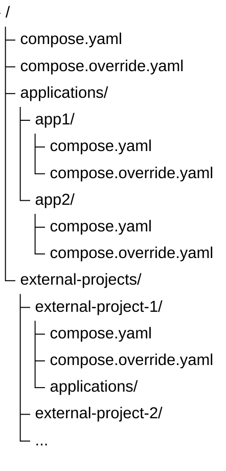
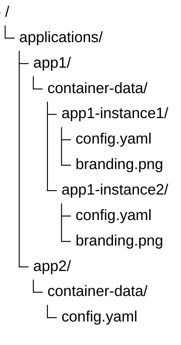
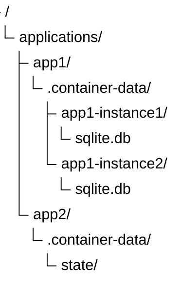
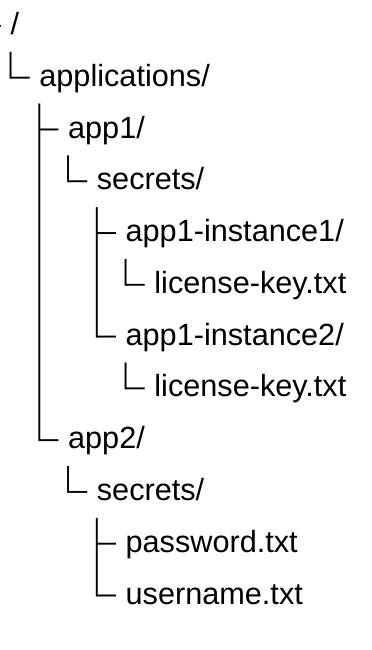

# [Hack Portland](https://www.meetup.com/hack-portland/) Self-Hosting Presentation

This repository is a practical blueprint for running a self-hosted ecosystem without turning it into a fragile collection of one-off scripts and ad hoc configuration. The goal is simple: keep the stack affordable, recoverable, secure, and easy to expand.

The question I get most often in the Hack Portland Meetup group is how I self-host a large number of services while keeping control of their data and avoiding a maintenance burden. The answer is a mix of version-controlled configuration, containerization, automation, and careful network design. This repo demonstrates that pattern in a way that can be adapted to a real homelab or a similar self-hosted environment.

Throughout this guide, I will mark the limited paid services with **`($)`**.

### Goals for this self-hosted setup
- **Minimal cost**
	 Use free-tier services where possible and only pay when the tradeoff is genuinely worth it.
- **Minimal maintenance effort**
	 Use automation and IaC to reduce the time spent upgrading, replacing, and reconfiguring services.
- **Minimal recovery effort**
	 Design the system so a hardware issue, failed update, or service outage does not require rebuilding the whole stack from memory.
	 *Backup and restore practices are covered later in this guide.*
- **Professional techniques**
	 Apply infrastructure patterns commonly used in real IT and DevOps environments, even in a homelab.
- **Privacy**
	 Reduce dependence on third-party services that monetize user behavior or lock data into proprietary ecosystems.
- **Security**
	 Use strong defaults, network separation, and careful exposure controls rather than assuming a stack is safe by default.
- **Portability**
	 Keep critical configuration in version control and use containerization so the environment can move between systems with minimal friction.
- **External accessibility**
	 Use outbound-only connections, DNS management, and secure tunneling so services can be reached from anywhere without exposing a large attack surface.
	 <u>If your goal is only local network access, skip sections marked `optional: required for external accessibility`.</u>

### How to use this repository

This repo is organized as a fully functional homelab setup that will be deployed in a live demo and can be cloned elsewhere as a starting point for your own self-hosted environment. It demonstrates how to structure:
- cloud resources with Terraform
- service deployment with Docker Compose
- persistent data and secrets management
- ingress, networking, and reverse-proxy routing
- maintenance and recovery habits for a long-lived homelab

While not a one-click install, there are sub-documentation and examples to guide you through the configuration required for running this homelab setup.

## Technologies and Services Used
- **Domain Registration**
	- **($)** [Porkbun](https://porkbun.com/about) for affordable, unlocked domain registration
- **Version Control**
	- [Git](https://git-scm.com/) for version control of IaC and configuration files
- **Containerization**
	- [Docker](https://www.docker.com/) for containerizing services and keeping them easy to move and update
- **Infrastructure as Code (IaC)**
	- [Docker Compose](https://docs.docker.com/compose/) for defining and running the containerized services on my homelab
	- [Terraform](https://www.terraform.io/) for provisioning and managing cloud resources
- **Cloud services**
	- [Cloudflare R2](https://developers.cloudflare.com/r2/) for centralized, no-cost cloud storage of Terraform state
	- [Cloudflare Tunnel](https://developers.cloudflare.com/cloudflare-one/connections/connect-apps/) for protected access to self-hosted services and domain portability
	- [GitHub](https://github.com/about) for remote repository hosting of version-controlled files
	- [Google Cloud Platform (GCP) OAuth Client](https://support.google.com/cloud/answer/15549257) for authentication and authorization of secured tunnel routes
- **Self-hosted services**
	- [Microsoft Devcontainers](https://github.com/devcontainers/images) for a secure, remote-accessible, and enriched shell and development environment for managing IaC and configuration files
	- [File Browser](https://filebrowser.org/) to replace cloud storage services like Google Drive, Dropbox, and OneDrive for file access and management
	- [Grafana](https://grafana.com/) for monitoring and visualizing logs (and eventually metrics) from my homelab and self-hosted services
	- [NordVPN](https://nordvpn.com/) for secure, encrypted, and private internet access from my homelab
	- [Photoprism](https://photoprism.app/) to replace cloud photo storage services like Google Photos, Apple iCloud, and Amazon Photos for photo access and management
	- [Pi-hole](https://pi-hole.net/) for network-wide ad-blocking and DNS filtering to enhance privacy and security of my home network and devices
	- [Traefik](https://traefik.io/) for reverse proxying and TLS termination of my self-hosted services

## Getting Started
Before you start writing infrastructure, make sure the environment is aligned with the design of the stack.

1. **Prepare your hosting environment**
	 This could be a Raspberry Pi, a laptop tucked away in a closet, a dedicated homelab server, or a small cloud VM **($)**.
	- Ensure you have enough CPU, memory, and storage for the services you plan to run.
	- Ensure reliable network connectivity and good power stability if this is a homelab device.
	- Keep the host OS and core software up to date.
	- Install the following tools:
		- Docker
		- Docker Compose
		- Git
		- Terraform (optional, or use another host or the development container included in this repository)

1. **Create a free Cloudflare account** or use an existing one
	 *(optional: required for external accessibility)*
	 Cloudflare offers a helpful free tier for DNS management, object storage, and secure tunneling. That makes it a strong fit for self-hosting without opening a large number of ports or relying on fragile home-router setups.
	- Follow-up steps:
		- Create a Cloudflare API token with permissions for Terraform management of your site.
			- Because your site (a.k.a. Cloudflare "Zone") is not created yet, you cannot create a token scoped to only that zone. Instead, create a token with "Zone Resources" scopes set to "All zones from an account", then tighten it later once the zone exists.
			- See [Appendix: Cloudflare API Token Permissions](#cloudflare-api-token-permissions) for the required permissions.
		- Create a free R2 bucket for the Terraform state backend and generate an R2 API token for access.
			 https://developers.cloudflare.com/terraform/advanced-topics/remote-backend/

1. **Obtain a domain name** or use an existing one that supports DNS management by Cloudflare
	 *(optional: required for external accessibility)*
	 A domain name gives your services human-friendly URLs and makes them reachable without a static IP. It is one of those things that looks optional until you actually want to use the stack from outside your local network.
	- I use Porkbun as my registrar:
		- Cheap domains
		- Unlocked domains, [in contrast to Cloudflare](https://porkbun.com/about/porkbun-vs-cloudflare)
		- Reliable enough that it has been my choice for years

## Deploy your Cloud Infrastructure
*(optional: required for external accessibility)*

This is the layer that makes external access possible without exposing your entire home network. The key idea is to treat cloud resources with the same care and repeatability as the services running on the host.

Terraform is used here to automate what can be automated: DNS, tunnel configuration, and other cloud-side resources that should be reproducible. Some steps still require manual dashboard work, but the goal is to keep the architecture declarative wherever possible.

This section covers:
- Terraform structure for a modular deployment
- Cloudflare DNS and Zone setup
- Cloudflare Tunnel as the public ingress point
- the manual steps that still exist for provider-specific setup

### Theory: Structuring your Terraform project
*(optional: required for external accessibility)*

To keep with the modular structure that will be set up with the Compose project, Terraform specific to a service should be in that service's directory. Similar to the root Compose file, the root Terraform module is the sole exception to this, as it must reference the application submodules to create the full infrastructure. To avoid also leaking service information required to configure routes into the `cloudflared` module definition, we can make use of dynamic Terraform to pass the configuration through the root module: more on this in the [Ingress](#ingress) section.

This means that creating or removing a service will involve touching the root and the service's Terraform files, but maintaining a service will generally only involve touching the service's Terraform files.

Use the following articles, as well as the contents of this repository, to plan and create your Terraform configuration files.
- https://www.terraform-best-practices.com/
- https://registry.terraform.io/

### Manage your Domain with Cloudflare

The objective of this section is to add your domain to Cloudflare for DNS management, which is a prerequisite for using Cloudflare Tunnel to securely expose your self-hosted services to the internet.

For me, this section represents the most work done by hand in online dashboards to create my cloud resources, due to Porkbun not having a comprehensive Terraform provider.

If you use a different registrar that supports Terraform, you may be able to automate more of these steps. And if you use Cloudflare as your registrar, you can skip most of these steps entirely.

1. **Disable DNSSEC at your registrar** if your registrar is not Cloudflare
	 [DNSSEC](https://www.cloudflare.com/learning/dns/dnssec/how-dnssec-works/) is good for security, but Cloudflare will manage it for you once your domain is managed there. Cloudflare provides links to instructions for many popular registrars.
	 https://developers.cloudflare.com/dns/zone-setups/full-setup/setup/#before-you-begin

1. **Terraform-apply the minimal resources required/recommended to create a Cloudflare site**
	- `cloudflare_zone` - to create and manage your Cloudflare Zone (i.e. your site/domain)
	- `cloudflare_zone_dnssec` - to enable DNSSEC for your site

1. **Update your domain's nameservers at your registrar** if your registrar is not Cloudflare
	 When managed by Cloudflare, your domain must use the Cloudflare nameservers assigned to your zone. Cloudflare provides links to instructions for many popular registrars.
	 https://developers.cloudflare.com/dns/zone-setups/full-setup/setup/#update-your-registrar

1. **Re-enable DNSSEC at your registrar** if your registrar is not Cloudflare
	 Now that Cloudflare is managing your domain, you can re-enable DNSSEC using the DS record values provided by Cloudflare, which you can find in the Terraform output of this repository. You can re-use the same instructions from the step to disable DNSSEC.

At this point, you can view your domain in the [Cloudflare dashboard](https://dash.cloudflare.com/), but accessing it in a browser will result in the error `DNS_PROBE_FINISHED_NXDOMAIN` because no DNS records exist yet (unless you had existing records prior to moving to Cloudflare).

### Create DNS records for your domain

To reach your self-hosted services via your domain, you need to create [DNS](https://www.cloudflare.com/learning/dns/what-is-dns/) records that point to the Cloudflare Tunnel that will be the gateway to your services.

In the past, I have created DNS records per subdomain (e.g. `service1.example.com`, `service2.example.com`) in order to be more declarative about my infrastructure and to keep the door open for using other hosting methods under the same domain or changing proxy status in the future. This approach has the downside of lag-time between creating DNS records for new services and being able to access the services, due to DNS propagation time.

For this site and demonstration, I am using a wildcard DNS record to point all subdomains to the same Cloudflare Tunnel. Note that this still requires an additional DNS record for the apex/root domain (e.g. `example.com`) if you want to host services there as well.

1. **Terraform-apply the Cloudflare Tunnel and the DNS record(s) pointing to it**
	- `cloudflare_zero_trust_tunnel_cloudflared` - to define the cloud-side of the Cloudflare Tunnel
	- `cloudflare_dns_record` - to create the DNS record(s) pointing to the tunnel

> [!WARNING]
> DNS changes take time to propagate: you can continue with deploying your infrastructure and services but may not be able to access them via your domain until propagation is complete.

Once the DNS entries propagate, accessing your domain will result in a HTTP 530, Cloudflare 1033, error page: you have successfully set up DNS resolution to reach Cloudflare servers, but have not yet set up the tunnel to receive and route traffic to your self-hosted services. The other end of the tunnel is the `cloudflared` container covered in [Ingress](#ingress) while the routes to your services are covered in each service's respective section.

#### Footnote: Cloudflare Tunnel Terms of Service
Cloudflare Tunnel [ToS](https://www.cloudflare.com/en-gb/service-specific-terms-application-services/#content-delivery-network-terms) prohibits certain types of content and traffic, such as video streaming, when using their CDN. If you want to access such content off your hosting environment's network, my research indicates that disabling the proxy status of the DNS record (i.e. using "DNS only" mode) should make you compliant. There are security implications to consider when doing so: do your research.

### Create Cloudflare Tunnel identity providers for additional security
*(optional: recommended for additional security)*

To enhance the security of your self-hosted services, you can configure identity providers (IdPs) in Cloudflare Tunnel to require authentication before traffic ever reaches your hosting environment. This can greatly assist your services that may have slower vulnerability patch cycles or lack robust built-in authentication mechanisms.

> [!WARNING]
> This is not a replacement for securing your services themselves, and will not affect requests that bypass the tunnel (e.g. direct IP access or LAN access).

To my dismay, I learned while writing this document that GCP does not have all the Terraform resources required to manage the GCP components of this integration using IaC, so you will need to do some manual configuration in the GCP dashboard. Cloudflare has good documentation for this integration: https://developers.cloudflare.com/cloudflare-one/integrations/identity-providers/google/

## Deploy your Self-Hosted Services

This is the operational core of the project: a set of containerized services, each with a clear purpose, a data model, and a specific relationship to the rest of the stack.

The real goal is not simply to run containers. It is to make each service predictable, recoverable, and easy to reason about. That means keeping configuration in version control, separating runtime state from static config, and structuring the platform so components can be added, replaced, or rebuilt without turning the whole system into a fragile pile of manual work.

This repository uses Docker Compose as the deployment model, with each application directory acting like a self-contained unit. That modularity keeps the project scalable and prevents it from becoming a single monolithic host configuration.

This section covers:
- how the Compose project is organized
- how configuration and runtime data are separated
- how secrets are handled safely
- how services are networked and exposed
- how the stack remains maintainable over time

### Theory: Structuring your Compose project

Use the following references alongside the contents of this repository when you are designing your own Compose layout:
- https://medium.com/@kinghuang/docker-compose-anchors-aliases-extensions-a1e4105d70bd
- https://docs.docker.com/compose/how-tos/use-secrets/
- https://docs.docker.com/compose/how-tos/multiple-compose-files/

#### Repository Layout

The layout is intentionally modular. The root Compose file acts as a thin entry point, while each application directory owns its own service definitions, secrets, and persistent data layout. This keeps concerns separated and makes it much easier to add or remove a service without disturbing unrelated parts of the stack.

Compose override files are also part of the strategy. They let you layer environment-specific configuration without duplicating the entire project. That is useful when you want a dev setup, a staging environment, or a host-specific change without modifying the production definition that is stored in version control.

Using override files at the root level means you can extend a shared base stack with additional local Compose projects while still keeping one clean entry point for commands like `docker compose ...`.

#### YAML Organization and Reuse

Docker Compose supports YAML anchors and reusable blocks, which is useful when multiple services share the same pattern. Rather than repeating the same environment, labels, or network configuration by hand, you can define common blocks once and reuse them where needed.

This reduces copy-paste drift and keeps the stack easier to maintain over time. It also makes the setup easier to explain, because the patterns become consistent across services rather than ad hoc from one app to the next.

#### Service Lifecycle Patterns

"If it's worth doing, it's worth doing all the way."

A major principle in this project is that services should not be started and then manually configured ad hoc in a browser or CLI after the fact. That approach may seem quick in the moment, but it creates operational debt. If you ever need to rebuild the host, move services to a new machine, or recover from a disk failure, you end up replaying a bunch of fragile manual setup steps.

The best services allow for most or all of their configuration to be expressed in files, environment variables, and startup automation. When a service cannot be fully configured that way, the repository uses a lightweight bootstrapping pattern with temporary setup containers.

These ephemeral setup services run before the main application and handle initial configuration tasks, such as creating accounts, generating config, or preparing required data directories. This keeps the actual service definition cleaner and makes the setup more repeatable. The repository enforces the dependency flow with Docker Compose's `depends_on` syntax so the setup runs first and only proceeds when it succeeds.

While widely used, the `depends_on` pattern is not a perfect pattern, as it leaves stopped setup containers lingering, which require manual cleanup. To cover this use-case gap with official features, Compose, in late 2025, gained native [init containers](https://docs.docker.com/compose/how-tos/init-containers/) support, but it still does not cover all of the advanced override use cases needed for complex bootstrapping (like overriding `entrypoint`). For now, the `depends_on` pattern remains the pragmatic choice here.

#### Persistent Data Layout

Services need persistent data for a reason: if the container is replaced or restarted, the application should not have to be rebuilt from scratch. The important distinction is between data that belongs in version control and data that belongs in a runtime state directory.

##### Version-Controlled

Configuration files, branding assets, and other static content are kept in visible `applications/<service>/container-data[/<service-instance>]` directories and bind-mounted into the container at runtime. This keeps the repository self-documenting and makes it easier to review changes in Git.

That file layout is helpful in a few ways:
- it keeps config close to the service that uses it
- it makes updates easier to review and track
- it avoids embedding large or sensitive config directly in Compose files

##### Non-Version-Controlled; State-Critical

Some data is stateful and too sensitive or too dynamic to store in Git. This is where hidden runtime directories come in. The repository uses `applications/<service>/.container-data[/<service-instance>]` to hold critical runtime state that should persist across restarts but should not be casually browsed or accidentally committed.

This pattern is useful because it:
- mirrors the visible data layout for predictability
- hides the runtime data from casual repository browsing
- keeps `.gitignore` rules simple and effective
- fits naturally into standard filesystem backup strategies

##### Non-Version-Controlled; Non-Critical

Some stateful data is not mission-critical. If it is lost during a migration or an update, the impact is annoying but not catastrophic. In those cases, Docker volumes are usually the best fit: persistent enough to survive restarts, easy to recreate, and not worth the operational overhead of manual backup planning.

#### Secrets Management

Secrets are different from ordinary config. They are managed by the administrator, not by the application itself, and they are critical to the service working as expected. They should also not live in version control, even when they are technically easy to store there.

This repository stores secrets in `applications/<service>/secrets[/<service-instance>]` and mounts them into containers using Compose's [`secrets`](https://docs.docker.com/compose/how-tos/use-secrets/) feature.

A good practice for any serious service is to support `FILE_*` or `*_FILE` environment variables so the application reads secrets from disk rather than from plain environment variables or command flags, which are much easier to leak through process inspection or logs.

#### Networking and Exposure

##### Network Segmentation

A self-hosted platform is easier to secure when services are not all sitting on the same network and talking to each other freely. This project uses network segmentation as a practical alternative to more traditional firewall ACL patterns, which are not natively available in Compose.

The rule of thumb is simple:
- place each service or service group on its own isolated network
- allow only the required connections with `attachable=false`
- keep services that do not need internet access on `internal` networks

This limits damage if one service is compromised. An attacker may get access to one container, but the blast radius is reduced because that container cannot easily reach unrelated parts of the stack.

In the diagram below, each edge represents one unique Docker Compose network.

##### VPNs

This repository currently uses a VPN client model for outbound traffic rather than exposing services directly to the internet through a home-router port-forwarding setup. That approach is intentional: it keeps the environment more private, gives the platform a stronger security posture, and helps avoid a common problem in self-hosted stacks where a single exposed service becomes the weak point in the entire network.

The key concept is a "kill switch" pattern. If the VPN connection drops, any/all attached services lose the ability to reach external networks, which prevents a service from silently leaking traffic outside the intended path. This is especially useful for services that should only communicate over the VPN to avoid accidental privacy or security leaks.

###### VPN Clients

A VPN client allows a container or group of containers to route outbound traffic through an encrypted tunnel before it reaches the wider internet. This approach is useful for privacy, for crossing geo-restrictions when appropriate, and for enforcing a clean network boundary for services that should not have unrestricted internet access.

In Docker Compose, a service can be attached to another container's network stack using `network_mode`, which is the relevant pattern here. That allows a service to share the networking context of the VPN client container, ensuring traffic is routed through the tunnel. If the VPN connection drops, the service loses outbound connectivity and effectively fails closed rather than continuing with unsecured traffic.

A few important caveats come with this model:
- services that need to talk to the VPN-attached service must also be on the same network
- the VPN-attached service must be addressed by the VPN container's alias or service name; port-based addressing is required to differentiate between services on the same network
- split tunneling must be configured for trusted internal traffic so it does not get unnecessarily routed out through the VPN
- multiple services using the same VPN client share the same network context, which weakens the segmentation model if you are trying to isolate every service completely

If your VPN provider allows it, running separate VPN client containers per high-risk or high-sensitivity service may be a better long-term choice than sharing a single client across the entire stack.

#### Plug-and-Play Integrations

Some services are designed to integrate with the rest of the Docker ecosystem through the Docker socket. Rather than manually editing static config files, they can discover containers and routes dynamically using labels, metadata, and runtime information.

Grafana and Traefik are two useful examples of this pattern. Traefik can automatically route traffic based on labels attached to downstream containers, while Grafana can read container metadata and use that to build dashboards or monitor the health of services more contextually.

This is a powerful pattern because it reduces configuration drift and makes the platform more maintainable. It also introduces a tradeoff: if a container has access to the Docker socket, it can observe and potentially influence the broader runtime environment. That is why this pattern should be used carefully and ideally behind tighter security boundaries, such as [socket-proxy](https://hub.docker.com/r/linuxserver/socket-proxy) containers.

This repo does not rely on the Docker socket for every service, but it does demonstrate a reasonable middle ground where automation is useful without sacrificing too much control.

### Infrastructure

Before choosing services, it is worth thinking about the infrastructure that supports them. The goal is not just to run a bunch of useful apps, but to build a platform that is secure, manageable, and resilient over time.

A good foundation makes the rest of the stack easier to maintain, easier to migrate, and easier to recover if something fails.

#### Ingress
*(optional: required for external accessibility)*

If you want your services to be accessible from outside your local network, you need to think carefully about ingress, reverse proxying, and TLS termination. The goal is to expose the right traffic to the right places without turning your home network into a poorly managed public endpoint.

The three most common approaches are:
- Port forwarding
- VPN
- **Proxy using a third-party service** -- the model used in this guide

##### Port Forwarding

Port forwarding is the least secure of the common options. It exposes specific ports directly to the internet and requires careful firewalling and service hardening to be viable. It can work for a small setup, but it is not the pattern I would recommend for a broader self-hosted environment unless you have a strong reason to do so.

##### VPN

A VPN approach lets you securely connect to your home network from an external location, effectively making your device part of the local network.

This method adds a significant layer of security by requiring comprehensive authentication and encrypting the traffic between your device and your home network and is a good model when the priority is private access from trusted devices, but comes with the drawbacks of added complexity, potential performance overhead, and VPN-client requirements for your devices.

Establishing a VPN connection is accomplished in conjunction with one of the other two strategies.

###### VPN with Port Forwarding

In this model, you combine port forwarding with a VPN by only exposing the VPN endpoint to the public internet, while all other services remain accessible exclusively through the local network via the VPN.

This approach minimizes the attack surface exposed to the internet while ensuring that the one exposed service (the VPN) is well-protected.

###### VPN with Proxy Using a Third-Party Service

Instead of exposing ports, your locally-running VPN server connects to a third-party proxy service, which then handles incoming traffic and forwards it securely to your internal network.

This setup allows you to benefit from the security of a VPN while leveraging the convenience and protection of a managed proxy service.

##### Proxy Using a Third-Party Service

A proxy service acts as a secure intermediary between your internal services and the public internet. Instead of exposing your internal network or services directly, you deploy one service that connects outbound to a trusted proxy provider, which then manages incoming external traffic and forwards it to your local backend service. The local backend service then can then securely route the traffic to the appropriate internal service based on the request details.

This is the pattern used in this repository because it balances security, convenience, and practicality. It avoids exposing any ports, supports custom domains, and gives you a clean path to HTTPS and TLS termination without requiring every internal service to manage its own certificate lifecycle.

The tradeoff is that you are adding a dependency on a third-party service for availability and policy enforcement, which is not free of operational risk. That is why the architecture still matters: network isolation, strong service security, and a clean reverse proxy model remain important even when the edge is managed by a provider.

##### Cloudflare Tunnel

This guide uses Cloudflare Tunnel as the edge access model, and it is a strong fit for a self-hosted deployment because it offers:
- free access for many personal projects
- support for custom domains from almost any registrar
- a simple outbound-only model that avoids direct port exposure
- strong security features and a managed edge layer
- good reliability and operational simplicity

The tunnel gives you a clean external-access path while keeping the services themselves on a private network behind the edge.

#### Reverse Proxy; TLS Termination

Once you have an ingress strategy in place, the next layer is the reverse proxy. A reverse proxy sits in front of your internal services and routes incoming traffic based on hostnames, paths, and other request metadata. It centralizes a lot of operational complexity and makes the overall stack much easier to manage.

##### TLS

Transport Layer Security (TLS) is the encryption layer that protects traffic between clients and services. It prevents eavesdropping and tampering and also verifies the identity of a service through certificates. When you use HTTPS, the connection is encrypted before it reaches the application layer.

The real challenge is not just enabling HTTPS, but doing it correctly and at the right layer. It is much easier to terminate TLS at the edge or in a single reverse proxy than to configure certificates individually for every service. That is why a central proxy is so useful.

[Let's Encrypt](https://letsencrypt.org/) is the standard choice for free certificates, and tools like [Certbot](https://certbot.eff.org/) and Traefik can manage renewal automatically. For setups using Cloudflare Tunnel, Cloudflare itself can terminate TLS before the request reaches your internal services, though you still want HTTPS between the edge and the internal service when possible for end-to-end security and traffic originating from inside your network.

##### Reverse Proxy

A [reverse proxy](https://www.cloudflare.com/learning/cdn/glossary/reverse-proxy/) sits in front of your application services and forwards client requests to the correct backend. That means services can be exposed through friendly URLs, rather than IP addresses and ports that are difficult to remember and harder to secure.

The same reverse proxy can also handle:
- TLS termination
- HTTP-to-HTTPS redirects
- path-based or host-based routing
- load balancing
- middleware for authentication or rate limiting
- middleware for caching or compression

This is a huge simplification in a self-hosted environment because it keeps ingress and routing logic centralized instead of repeating it across every app.

##### Traefik

Traefik is the reverse proxy of choice in this project for a few reasons:
- it is dynamic and can update routing without restarting the service
- it integrates easily with Docker labels and container metadata
- it has built-in support for automatic certificate management
- it supports advanced middleware features without adding a lot of operational overhead

This makes it a natural fit for a modular self-hosted ecosystem where services are frequently added or updated.

[SWAG (Secure Web Application Gateway)](https://docs.linuxserver.io/general/swag/) was the previous reverse proxy choice in my homelab. It is a strong solution and still a good option in many environments, but it felt more cumbersome and less naturally automated than Traefik for a dynamic container-driven setup.

#### Logging; Monitoring

Once the system is running, the next concern is visibility. This is one of the boring but crucial parts of operations: without logs and monitoring, you do not know when a service is failing, when a dependency is unhealthy, or when a configuration change has broken something unexpectedly.

##### Logging

Docker gives you baseline logs with `docker logs <container_name>`, which is often enough for basic debugging. That said, a raw stream from multiple containers gets difficult to work with quickly once the platform grows beyond a few services.

That is where centralized logging tools become valuable. A system like Grafana, often paired with an aggregator and log pipeline, helps you:
- collect logs from many services in one place
- search and filter them efficiently
- correlate events across multiple containers
- set up alerts for failure patterns or unusual behavior

Good logging habits matter more than the specific tool. Structured logs, sensible log levels, and a retention policy are all important. In production, you usually do not want everything at debug level all the time, but you do want enough detail to diagnose real issues quickly.

##### Monitoring

Monitoring is broader than logs. It includes CPU usage, memory, disk usage, network traffic, health checks, and the status of services over time. This gives you a more complete picture of how the platform is performing and helps catch issues before they become a user-facing outage.

A stack like [Prometheus](https://prometheus.io/docs/introduction/overview/) plus Grafana is a common fit for this kind of setup, and it works well with a containerized self-hosted environment. The important thing is to monitor the things that matter, not just every metric available in the ecosystem.

#### Maintenance Access

The easiest way to cause operational friction in a homelab is to make the maintenance environment feel different from the rest of the stack. If you need a random workstation or an SSH session with a bunch of ad hoc tooling, the system becomes harder to maintain and harder to reproduce.

That is why this repository uses a devcontainer-based maintenance environment. [Microsoft's development containers](https://github.com/devcontainers/images) provide a repeatable shell environment with the tools you need already installed. Adding a [Visual Studio Code Server](https://code.visualstudio.com/docs/remote/vscode-server) layer gives you a secure, browser-based access method without opening port-forwarding rules to the outside world.

This pattern turns maintenance into part of the same reproducible infrastructure model as the rest of the stack. It also makes it easier to run updates, inspect configs, and troubleshoot from anywhere without introducing host-level drift.

Finally, this repository uses [Docker-out-of-Docker](#docker-out-of-docker) so the devcontainer can interact with the host's Docker daemon directly. That gives the maintenance environment enough access to manage the stack without forcing you to install every admin tool on the host itself.

### Other Services

At this point, the stack is no longer a generic concept; it is a real ecosystem of services with different roles. The following examples are included to illustrate the kind of workloads this setup is meant to support.

#### DNS Server - Pi-hole

Pi-hole is a network-wide ad blocker and DNS filtering tool. It sits in front of your clients and can block unwanted advertising, tracking domains, and other categories of traffic before they ever reach your devices.

This has a few practical benefits:
- cleaner browsing and less tracking
- reduced outbound noise from the network
- more centralized control over DNS policy
- a useful place for local DNS entries and service discovery

The tradeoff is that if Pi-hole goes down, your devices may lose DNS resolution unless they have a fallback path configured. For that reason, it is best treated as part of your core infrastructure rather than a decorative add-on.

#### File Access - File Browser

File Browser provides a user-friendly interface for managing files in a self-hosted environment. It serves a similar practical role to cloud-storage UIs such as Google Drive or Dropbox, but without the vendor lock-in and the tracking that often comes with those services.

It is useful for personal file access, backups, and straightforward document management, especially when the goal is to move away from proprietary cloud ecosystems.

> [!TIP]
> File Browser is now in maintenance mode. It is still a useful project and works well for a lot of self-hosted setups, but if you are starting a new system today, it is worth considering [FileBrowser Quantum](https://github.com/gtsteffaniak/filebrowser) as a more modern alternative.

#### Photo Management - Photoprism

PhotoPrism gives you a self-hosted alternative to cloud photo libraries like Google Photos or iCloud Photos. It helps organize photos, apply metadata, and make large personal libraries searchable and manageable without sending everything to a third-party service.

This is one of the clearest examples of a self-hosted service replacing a convenience product that often comes with privacy tradeoffs.

### Honorable Mentions

These are services worth considering if you want to expand this ecosystem further:
- [Calibre](https://docs.linuxserver.io/images/docker-calibre/) - E-book management
  - [Calibre-Web](https://docs.linuxserver.io/images/docker-calibre-web/) - browser-based reading and library access
- **($)** [Foundry VTT](https://hub.docker.com/r/felddy/foundryvtt) - virtual tabletop for role-playing games
- [Jellyfin](https://docs.linuxserver.io/images/docker-jellyfin/) - media streaming and library management
- [Sonatype Nexus Repository](https://hub.docker.com/r/sonatype/nexus3) - package repository hosting for internal tooling and dependencies

### Dishonorable Mentions

These are services I have used in the past and would not recommend for a new setup unless you have a very specific reason:
- Nextcloud - it tries to do too much at once, tends to be resource-intensive, and can become fragile during upgrades. It is often better to choose dedicated tools for file access, calendars, contacts, and other functionality instead of relying on a single broad platform.

## Plan for Maintenance and Recovery

At this point, the stack is running and the real work shifts to operations. A platform is not “done” once it is deployed; the real value comes from making it easy to update, easy to restore, and not dependent on a fragile memory of what was configured last month.

### Updates and Maintenance

The entire point of IaC and containerization is to reduce the amount of manual work in day-to-day operations. Instead of logging into a bunch of systems and making changes by hand, you can update configuration files, review the diffs, and reapply the same pattern consistently.

This repo also keeps a devcontainer as a maintenance environment. That means you can do operational work from any device with a browser, without needing to install a bunch of extra software on your homelab host.

When selecting a Docker image or version policy for a service, think about your tolerance for change:
- `latest` with `always` pull policy - best for early experimentation and low-risk services, but not for anything that needs stability
- mutable major tags like `1` or `2` with `always` - a good default when the project maintains backward compatibility well
- immutable-by-convention semantic versions like `1.2.3` with `missing` pull policy - useful for services that are sensitive to breaking changes
- truly-immutable sha256 digests with `missing` pull policy - the most conservative and secure option, but the most work to maintain

The right policy depends on the service and the amount of risk you are comfortable accepting.

### Backup and Restore

A system is only as good as its recovery plan. If you have a hardware failure, a bad upgrade, or an accidental delete, the question is not whether the system will be inconvenient; it is how quickly it can be restored.

#### Back up your Infrastructure and Configuration

The first rule is simple: keep your infrastructure and configuration in version control. That includes the Compose files, Terraform, static config, and any important service definitions that are meant to be reproducible. In this repository, anything not deliberately hidden is assumed to be tracked, with the exception of override files, `secrets/`, and a few Terraform resources that are intentionally left out of Git.

Use a remote Git provider as an offsite backup of your configs. A repository like GitHub or GitLab is not just for code; it is also a very practical disaster-recovery tool for the operational layer of your homelab.

#### Back up your Service Data

Stateful services should have a clear backup location and a simple restore path. This repo separates:
- version-controlled config in `container-data`
- critical runtime state in hidden `.container-data` directories
- secrets in `secrets/` and mounted as Docker secrets

That separation matters. It makes it easy to back up the data you actually care about without making everything part of a fragile, version-controlled blob.

Tools like [`rsync`](https://linux.die.net/man/1/rsync) are enough for many homelab setups. The point is not to over-engineer the process, but to make it easy enough that backups happen consistently rather than only after a disaster is already underway.

For planned migrations, you may wish to also tarball your non-critical runtime state Docker volumes to have a seamless switchover.

## Appendix

### Cloudflare API Token Permissions

When creating a Cloudflare API token for Terraform management of your site, the following permissions are the ones that matter most:
- **Account - Access: Apps and Policies - Edit**
  - `cloudflare_zero_trust_access_application`
  - `cloudflare_zero_trust_access_policy`
- **Account - Access: Organizations, Identity Providers, and Groups - Edit**
  - `cloudflare_zero_trust_access_identity_provider`
- **Account - Cloudflare Tunnel - Edit**
  - `cloudflare_zero_trust_tunnel_cloudflared`
  - `cloudflare_zero_trust_tunnel_cloudflared_config`
- **Zone - DNS - Edit**
  - `cloudflare_dns_record`
- **Zone - DNS Settings - Edit**
  - `cloudflare_zone_dnssec`
- **Zone - Sanitize - Edit**
  - `cloudflare_url_normalization_settings`
- **Zone - SSL/TLS - Edit**
  - `cloudflare_zone_setting` -> `ssl`
- **Zone - Zone - Edit**
  - `cloudflare_zone`
- **Zone - Zone Settings - Edit**
  - `cloudflare_zone_setting`

### Docker-out-of-Docker

Docker-out-of-Docker (DooD) is a pattern where a container can access and manage the host machine's Docker daemon instead of running its own isolated daemon. This is different from Docker-in-Docker (DinD), which creates a separate Docker runtime inside the container.

This is useful in maintenance containers that need to manage other containers on the host. In practical terms, it means the devcontainer can run Docker commands as if they were being issued directly on the host environment, which is convenient for operational work without having to install a large set of admin tools on the host itself.

The usual implementation is to mount the host Docker socket (`/var/run/docker.sock`) into the container. This gives the container direct access to the daemon. If you want to reduce the risk, you can also place a socket proxy in front of the Docker socket so the container only has the permissions it actually needs.
